

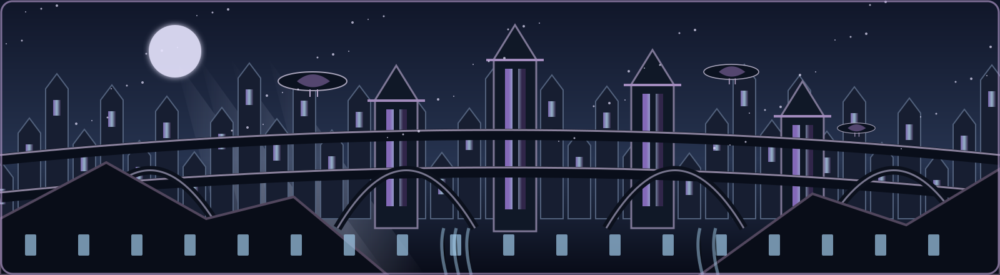

**COMPUTER ENGINEERING · DATA SCIENCE · AI/ML · FULL-STACK ENGINEERING**

*“Turning patterns into insight, and ideas into systems.”*

`SYSTEM: ONLINE`　·　`ACCESS: BUILDER`　·　`REALM: DATA × INTELLIGENCE`

## I. The archivist

I'm a Computer Engineering student pursuing an **Honours in Data Science**, interested in the space where data, intelligent systems, and software engineering meet.

I enjoy exploring datasets, finding patterns, building AI-powered tools, and turning complex ideas into useful products. My work spans Android engineering, full-stack platforms, LLM-powered applications, computer vision, and data-driven research prototypes.

<table>
<tr>
<td width="50%" valign="top"> **The pursuit** Data Science, Machine Learning, AI systems, and applied analytics.</td>
<td width="50%" valign="top"> **The craft** Full-stack products, LLMs, agents, automation, and intelligent applications.</td>
</tr>
<tr>
<td width="50%" valign="top"> **The question** How can raw information become meaningful decisions?</td>
<td width="50%" valign="top"> **The method** Build, break, debug, learn, and rebuild.</td>
</tr>
</table>

> **CURRENT QUEST**　Build systems that are not only intelligent, but genuinely useful.

## II. The stained-glass codex

*Eight windows into the things I've been building. Each pane has its own heraldry; open one to enter its repository.*

<table>
<tr>
<td width="50%" valign="top" align="center">
<a href="https://github.com/Shade555/DigiPico"></a>
**DIGIPICO** An AI companion that makes technology less intimidating.

A gamified, mobile-first learning companion with a friendly AI tutor, personalised learning paths, quizzes, a JavaScript sandbox, XP, streaks, and achievements.

`Next.js` `Gemma` `Mastra` `MongoDB` `TabPFN` `Capacitor`

<a href="https://github.com/Shade555/DigiPico">ENTER THE REPOSITORY ↗</a>
</td>
<td width="50%" valign="top" align="center">
<a href="https://github.com/Shade555/Frameon"></a>
**FRAMEON** A gallery with a second layer of intelligence.

An Android gallery and security suite featuring real-time media sync, background OCR scanning for sensitive information, spatial text analysis, Luhn validation, and biometric-protected storage.

`Kotlin` `Jetpack Compose` `ML Kit` `WorkManager` `Hilt`

<a href="https://github.com/Shade555/Frameon">ENTER THE REPOSITORY ↗</a>
</td>
</tr>
<tr>
<td width="50%" valign="top" align="center">
<a href="https://github.com/Shade555/ProofPocket"></a>
**PROOFPOCKET** Paperwork in. Evidence-backed clarity out.

An open-weight AI paperwork agent that extracts and organises requirements, maps documents to evidence, flags missing information, and keeps a human in control of final decisions.

`Next.js` `TypeScript` `Gemma` `MongoDB` `OCR`

<a href="https://github.com/Shade555/ProofPocket">ENTER THE REPOSITORY ↗</a>
</td>
<td width="50%" valign="top" align="center">
<a href="https://github.com/Shade555/patchwork-ai"></a>
**PATCHWORK AI** A local-first assistant for messy data.

A Windows desktop tool for profiling and cleaning CSV/XLSX data, combining deterministic checks with local open-weight AI suggestions and human-reviewed corrections.

`C#` `.NET 8` `WPF` `Ollama` `ClosedXML`

<a href="https://github.com/Shade555/patchwork-ai">ENTER THE REPOSITORY ↗</a>
</td>
</tr>
<tr>
<td width="50%" valign="top" align="center">
<a href="https://github.com/Shade555/InterBrew"></a>
**INTERBREW** A gamified space for technical interview preparation.

A platform combining structured learning, AI-assisted mock interviews, interactive technical challenges, and performance tracking.

`Next.js` `React` `TypeScript` `Supabase` `Groq`

<a href="https://github.com/Shade555/InterBrew">ENTER THE REPOSITORY ↗</a>
</td>
<td width="50%" valign="top" align="center">
<a href="https://github.com/Shade555/spatiotemporal-disease-tracker"></a>
**MUMBAI SIGNAL WATCH** A spatiotemporal disease-news signal tracker.

A research build that ingests public news metadata, extracts disease signals, aggregates activity, and highlights unusual changes through a live dashboard. It tracks news signals, not confirmed case counts.

`Next.js` `Python` `NLP` `Supabase` `NewsAPI`

<a href="https://github.com/Shade555/spatiotemporal-disease-tracker">ENTER THE REPOSITORY ↗</a>
</td>
</tr>
<tr>
<td width="50%" valign="top" align="center">
<a href="https://github.com/Shade555/SubScout"></a>
**SUBSCOUT** Subscription management without scattered reminders.

A responsive subscription manager with multi-currency totals, authentication, real-time updates, and browser, push, and email reminders.

`React` `Vite` `Supabase` `PostgreSQL`

<a href="https://github.com/Shade555/SubScout">ENTER THE REPOSITORY ↗</a>
</td>
<td width="50%" valign="top" align="center">
<a href="https://github.com/Shade555?tab=repositories"></a>
**THE OUTER WINGS** Experiments beyond the main archive.

Open-source AI builds, hackathon prototypes, data projects, automation, and web experiments.

`Mundane` · `Space Arcade Canvas` · `Shadow Text Adventure` · `ProofPocket`

<a href="https://github.com/Shade555?tab=repositories">BROWSE ALL REPOSITORIES ↗</a>
</td>
</tr>
</table>

## III. The technology reliquary

## IV. The observatory — live statistics

*The instruments below are generated from account data. They are not hard-coded counters. The GitHub observatory refreshes on a schedule; the LeetCode instrument updates when its public endpoint responds.*

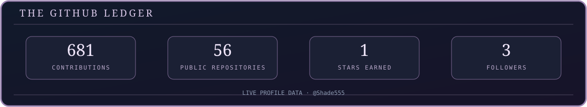


## V. Deeds beyond the archive

- **Open source:** Contributions through GirlScript Summer of Code and Social Summer of Code.
- **Hacktoberfest:** Participated in the 2026 Open Source AI Challenge, working on projects including Mundane, DigiPico, Patchwork AI, and ProofPocket.
- **MLH Global Hack Week:** Built and explored projects including Space Arcade Canvas and Shadow Text Adventure.
- **Technical leadership:** Technical Head, SFIT Alumni Association; Webmaster, Team Tejas; former Technical Executive, CSI SFIT.
- **Industry experience:** Full Stack Developer Intern at QuickYearning, contributing to a stock-market web application; AI Automation and Intelligent Solutions trainee through BharatCares × IBM SkillsBuild.

## VI. The next chapter

I'm interested in thoughtful collaborations, open-source projects, and opportunities involving **AI/ML, data science, intelligent applications, and software engineering**.

**Thanks for exploring my corner of the internet.**

*May your models converge and your builds never break in production.*

