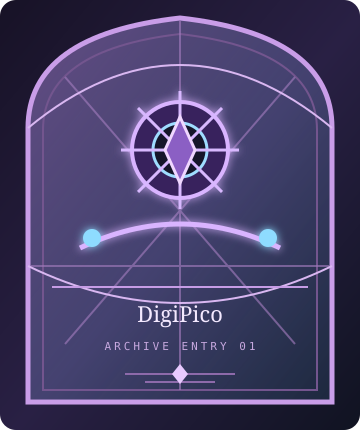
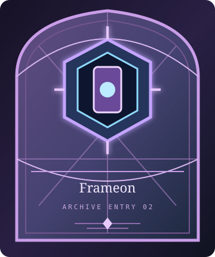
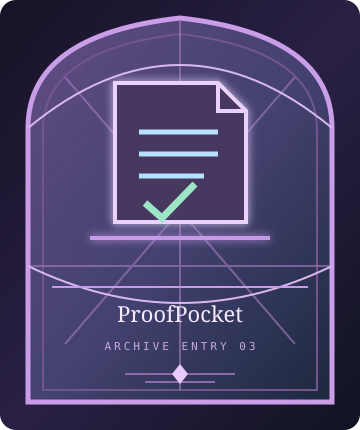
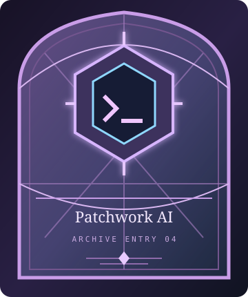
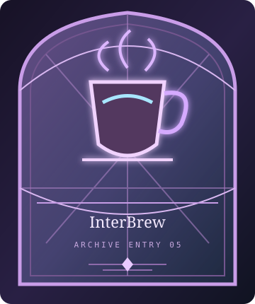
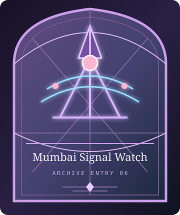

# SHADE555
### THE ARCANE SYSTEMS ARCHIVE

**Computer Engineering · Data Science · AI/ML · Full-Stack Engineering**

*“Turning patterns into insight, and ideas into systems.”*

[GitHub](https://github.com/Shade555) &nbsp; ◇ &nbsp; [LinkedIn](https://www.linkedin.com/in/slevin-cordeiro-76b2362a0/) &nbsp; ◇ &nbsp; [Visitor log](https://komarev.com/ghpvc/?username=Shade555&style=flat-square&color=8d63ad&label=VISITORS)

`SYSTEM ONLINE` &nbsp; · &nbsp; `ACCESS: BUILDER` &nbsp; · &nbsp; `REALM: DATA × INTELLIGENCE`

## I. The mind behind the mechanism

I'm a Computer Engineering student pursuing an **Honours in Data Science**, interested in the space where data, intelligent systems, and software engineering meet.

I enjoy exploring datasets, finding patterns, building AI-powered tools, and turning complex ideas into useful products. My work spans Android engineering, full-stack platforms, LLM-powered applications, computer vision, and data-driven research prototypes.

| FIELD NOTES | CURRENT PURSUITS |
|:--|:--|
| **Researching** | Data Science, Machine Learning, AI systems, and applied analytics |
| **Constructing** | Full-stack products, LLM applications, agents, and automation |
| **Investigating** | How raw information becomes meaningful decisions |
| **Method** | Learn by building, breaking, debugging, and rebuilding |

> **CURRENT QUEST** — Build systems that are not only intelligent, but genuinely useful.

## II. The stained-glass project gallery

*Six instruments from the archive. Each window records a different kind of work.*

<table>
<tr>
<td width="33%" align="center" valign="top">

**01 · DigiPico**

An AI companion that makes technology less intimidating.

`Next.js` `Gemma` `Mastra` `MongoDB` `TabPFN` `Capacitor`

[OPEN DOSSIER →](https://github.com/Shade555/DigiPico)
</td>
<td width="33%" align="center" valign="top">

**02 · Frameon**

A gallery with a second layer of intelligence.

`Kotlin` `Jetpack Compose` `ML Kit` `WorkManager` `Hilt`

[OPEN DOSSIER →](https://github.com/Shade555/Frameon)
</td>
<td width="33%" align="center" valign="top">

**03 · ProofPocket**

Paperwork in. Evidence-backed clarity out.

`Next.js` `TypeScript` `Gemma` `MongoDB` `OCR`

[OPEN DOSSIER →](https://github.com/Shade555/ProofPocket)
</td>
</tr>
<tr>
<td colspan="3">

An open-weight AI paperwork agent that extracts and organises requirements, maps documents to evidence, flags missing information, and keeps a human in control of final decisions.

</td>
</tr>
<tr>
<td width="33%" align="center" valign="top">

**04 · Patchwork AI**

A local-first assistant for messy data.

`C#` `.NET 8` `WPF` `Ollama` `ClosedXML`

[OPEN DOSSIER →](https://github.com/Shade555/patchwork-ai)
</td>
<td width="33%" align="center" valign="top">

**05 · InterBrew**

A gamified space for technical interview preparation.

`Next.js` `React` `TypeScript` `Supabase` `Groq`

[OPEN DOSSIER →](https://github.com/Shade555/InterBrew)
</td>
<td width="33%" align="center" valign="top">

**06 · Mumbai Signal Watch**

A spatiotemporal disease-news signal tracker.

`Next.js` `Python` `NLP` `Supabase` `NewsAPI`

[OPEN DOSSIER →](https://github.com/Shade555/spatiotemporal-disease-tracker)
</td>
</tr>
</table>

**Project records**

- **DigiPico:** A gamified, mobile-first learning companion with a friendly AI tutor, personalised learning paths, quizzes, a JavaScript sandbox, XP, streaks, and achievements.
- **Frameon:** An Android gallery and security suite featuring real-time media sync, background OCR scanning for sensitive information, spatial text analysis, Luhn validation, and biometric-protected storage.
- **Patchwork AI:** A Windows desktop tool for profiling and cleaning CSV/XLSX data, combining deterministic checks with local open-weight AI suggestions and human-reviewed corrections.
- **InterBrew:** A platform combining structured learning, AI-assisted mock interviews, interactive technical challenges, and performance tracking.
- **Mumbai Signal Watch:** A research build that ingests public news metadata, extracts disease signals, aggregates activity, and highlights unusual changes through a live dashboard. It tracks news signals, not confirmed case counts.

[VIEW THE COMPLETE REPOSITORY ARCHIVE →](https://github.com/Shade555?tab=repositories)

## III. The technology grimoire

*The instruments, languages, and frameworks in the working collection.*

**LANGUAGES & FOUNDATIONS**

**AI · DATA · INTELLIGENCE**

**WEB · MOBILE · BACKEND**

**DATABASES · TOOLS · INFRASTRUCTURE**

## IV. The observatory

*Live readings from the public engineering record.*

### The archive ledger

### The chronometer

### The constellation of activity

### The trial chamber

## V. Guilds, fieldwork & affiliations

- **Open source:** Contributions through GirlScript Summer of Code and Social Summer of Code.
- **Hacktoberfest:** Participated in the 2026 Open Source AI Challenge, working on projects including Mundane, DigiPico, Patchwork AI, and ProofPocket.
- **MLH Global Hack Week:** Built and explored projects including Space Arcade Canvas and Shadow Text Adventure.
- **Technical leadership:** Technical Head, SFIT Alumni Association; Webmaster, Team Tejas; former Technical Executive, CSI SFIT.
- **Industry experience:** Full Stack Developer Intern at QuickYearning, contributing to a stock-market web application; AI Automation and Intelligent Solutions trainee through BharatCares × IBM SkillsBuild.

## VI. The next chapter

I'm interested in thoughtful collaborations, open-source projects, and opportunities involving **AI/ML, data science, intelligent applications, and software engineering**.

### THANK YOU FOR VISITING THE ARCHIVE

*May your models converge and your builds never break in production.*

[RETURN TO THE GITHUB REALM →](https://github.com/Shade555)

SHADE555 · BUILDING A BETTER TOMORROW, ONE SYSTEM AT A TIME

